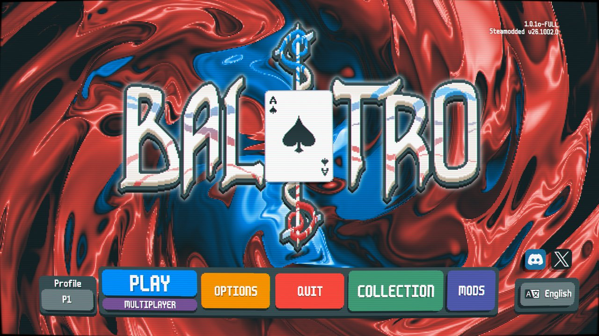
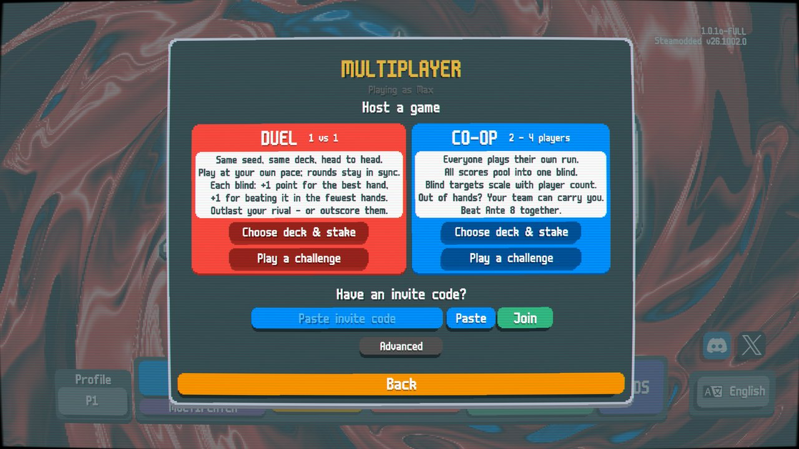
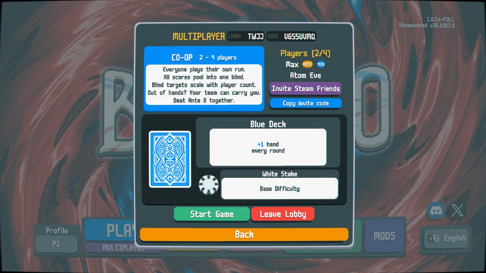
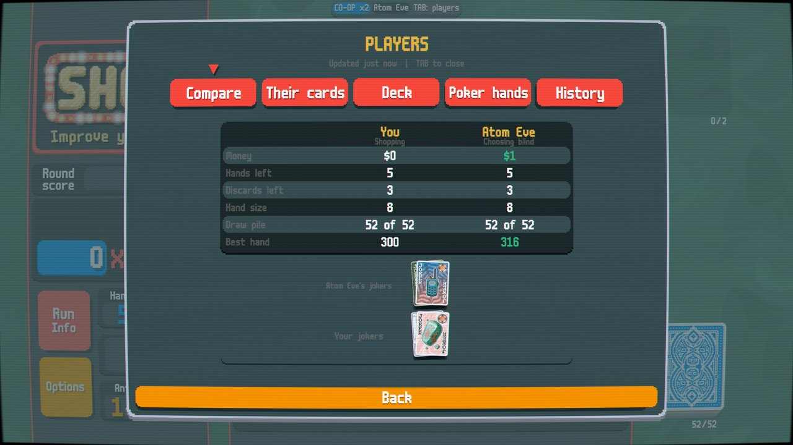

# Balatro Duel & Co-op

A Balatro mod (Steamodded). Any player can host from inside the game, and Steam friends join
through Steam itself: no server, port forwarding, tunnel or website. Each player runs their own
copy of Balatro, so everything plays exactly like the real game. Works on **Windows and Mac**,
and Windows and Mac players can play together.

- **Rules and edge cases:** [How multiplayer plays](docs/HOW-IT-PLAYS.md)
- **Feedback, ideas and bug reports:** [open an issue](https://github.com/maxmoundas/balatro-multiplayer/issues/new/choose)
  (see [Feedback](#feedback))

## Quick start

### What you need
- **Balatro on Steam, on a Windows PC or a Mac.** Every player needs their own copy, because Steam Family
  Sharing doesn't let two accounts play the same copy at once.
- **To be Steam friends with whoever is hosting.** Add each other under Steam → Friends → Add a
  Friend.
- **Your Steam status set to Online**, not Invisible or Offline. Invites and joining go through
  Steam's friend status.
- **Balatro launched at least once**, all the way to the main menu, so its save folder exists.

### Install on Windows
1. **Download the installer:**
   **[BalatroMultiplayer-Setup.zip](https://github.com/maxmoundas/balatro-multiplayer/releases/latest/download/BalatroMultiplayer-Setup.zip)**
   (this link always gives you the latest version).
   - You don't need the green **Code** button or the rest of this repo. The zip has everything.
2. **Unzip it:** right-click the zip → **Extract All** → **Extract**. Running `Install.bat`
   from inside the zip without extracting it won't work.
3. **Close Balatro** if it's open.
4. **Double-click `Install.bat`** in the extracted folder.
   - If Windows says "Windows protected your PC", click **More info** → **Run anyway**.
   - A window opens and installs three things: **Lovely** (the mod loader), **Steamodded** (the
     mod framework) and this mod. Anything already installed is skipped.
   - When it says **All done!**, press Enter to close it.
   - If it says it can't write to the game folder, right-click `Install.bat` →
     **Run as administrator**.
   - If it can't find Balatro, it asks for the game folder. To find it, go to Steam → right-click
     Balatro → Manage → Browse local files, then copy the address bar and paste it in.
5. **Launch Balatro from Steam.** The first launch with mods can take a little longer.
   A **MULTIPLAYER** button appears on the main menu, under **PLAY**. If it doesn't, press
   **F8** on the main menu.

   

### Install on Mac
1. **Quit Balatro** if it's open.
2. **Open Terminal** (Applications → Utilities → Terminal, or press ⌘ Space and type
   *Terminal*).
3. **Paste this line and press Enter:**
   ```sh
   curl -fsSL https://github.com/maxmoundas/balatro-multiplayer/releases/latest/download/install-mac.sh | bash
   ```
   - It installs the same three things: **Lovely**, **Steamodded** and this mod. Anything
     already installed is skipped.
   - If it can't find Balatro, it asks for the game folder. Go to Steam → right-click Balatro →
     Manage → Browse local files, drag the folder that opens into the Terminal window, and
     press Enter.
   - Prefer not to paste commands? Download and unzip the
     [zip](https://github.com/maxmoundas/balatro-multiplayer/releases/latest/download/BalatroMultiplayer-Setup.zip)
     instead, type `bash ` (with a space) in Terminal, drag `install-mac.sh` from the unzipped
     zip's `files` folder into the window, and press Enter.
4. **Launch Balatro from Steam** as usual. The **MULTIPLAYER** button appears on the main menu.

How it works on Mac: Lovely can't hook into the game the way it does on Windows, so the
installer puts a tiny launcher in place of the game's program (`Balatro.app/Contents/MacOS/love`;
the original is kept next to it as `love-original`). The launcher starts the original with
Lovely loaded, so launching from Steam and accepting Steam invites both start the modded game.
**If a Balatro update makes the MULTIPLAYER button disappear, run the install line again.**

### Updating
When a new version comes out, **every player must update**, because mismatched versions may not
work together. On Windows, download the zip again from the same link, extract it, and run
`Install.bat` again. On Mac, run the install line again. Either way it replaces the old version
of the mod and leaves Lovely and Steamodded as they are.

### Uninstalling
1. Close Balatro.
2. **Windows:** double-click **`Uninstall.bat`** in the folder you extracted. If you deleted that
   folder, download and extract the zip again.
   **Mac:** run this in Terminal:
   ```sh
   curl -fsSL https://github.com/maxmoundas/balatro-multiplayer/releases/latest/download/uninstall-mac.sh | bash
   ```
3. It removes this mod and its settings, then asks whether to also remove **Lovely and
   Steamodded**. Answer **N** (the default) if you use any other mods, because they need them.
   Answer **Y** to make Balatro completely unmodded again (on Mac this also puts the game's
   original program back).

Your Balatro save files are never touched.

### Play with a friend
1. **Host:** click **MULTIPLAYER**. Under **Duel** or **Co-op**, click **Choose deck & stake**
   (or **Play a challenge**), pick one, then **Play**.

   

2. **Host:** in the lobby, click **Invite Steam Friends** → **Invite** next to your friend.

   

3. **Friend:** what happens next depends on whether Balatro is open.
   - **Balatro is open:** an invite banner appears in the MULTIPLAYER menu. Click **Join**.
   - **Balatro is closed:** accept the invite in Steam chat. Balatro launches and joins the
     lobby by itself.
   - **No invite shows up:** the host clicks **Copy invite code** and sends it to the friend
     (on Discord, for example). The friend opens MULTIPLAYER, clicks **Paste**, then **Join**.
4. **Host:** once everyone is in the lobby, click **Start Game**.

In game: **F7** toggles the multiplayer status bar. **Tab** (or clicking the status bar) opens
the player viewer, where you can compare yourself with the other players: their jokers,
consumables, vouchers, tags and hand, their **whole deck** with every enhancement, seal and
edition, their **poker hand levels** next to yours, and the score of every blind.



Your name in multiplayer is your **Steam name**. To use a different one, set it under
MULTIPLAYER → **Advanced**. Leave the field empty to go back to your Steam name.

### If something goes wrong
- **"Their game didn't answer through Steam":** check that you're Steam friends, that both of you
  show as Online, and that the host's lobby is still open. Then try again.
- **The MULTIPLAYER button is missing:** run `Install.bat` again. If Balatro shows a Lovely or
  Steamodded error when it starts, take a screenshot and send it to the host.
- **Mac: Balatro starts without the MULTIPLAYER button:** a Balatro update probably replaced the
  launcher. Run the install line again.
- **Something else:** send the newest log file from Lovely's log folder:
  - Windows: `%APPDATA%\Balatro\Mods\lovely\log\`. Paste that path into the File Explorer
    address bar to open the folder.
  - Mac: `~/Library/Application Support/Balatro/Mods/lovely/log/`. In Finder, press ⇧⌘G and
    paste that path.
- **Other mods:** turn off mods that change scoring, like Talisman. They aren't supported yet.
- **Still stuck, or found a bug?** [Report it](https://github.com/maxmoundas/balatro-multiplayer/issues/new/choose)
  and attach that log file.

## Modes

This is a summary. [How multiplayer plays](docs/HOW-IT-PLAYS.md) has the full rules, including
what you see while waiting for other players and how cards like Mr. Bones, Hieroglyph and
Petroglyph work in multiplayer.

### Duel (1v1)
- Both players get the **same seed, deck and stake**.
- **Play at your own pace, but rounds stay in sync** (see [Round sync](#round-sync-both-modes)).
- After each blind both players have finished, points are awarded:
  - **+1** to whoever scored the single highest hand in that blind
  - **+1** to whoever beat the blind in the fewest hands (only players who beat it qualify)
  - If both tie on either category, both get the point.
- How a duel is decided:
  1. Both players beat the Ante 8 boss → most points wins.
  2. One player's run ends before the other's → the survivor wins. The survivor only has to get
     through the blind the other player lost on.
  3. Both runs end on the same blind → most points wins.
  4. A player who disconnects or returns to the main menu forfeits.
- Skipping blinds is allowed. A skipped blind gives the skipper no points for it.

### Co-op (2–4 players)
- Every player plays their own run (same seed). Only the **score** is shared. Decks, money,
  jokers and shops are each player's own.
- Each blind's requirement is multiplied by the number of players. At 3 players, a 300-chip
  blind needs 900.
- Teammates' scored hands are added to your chip counter as they happen. The blind is beaten
  when the team total reaches the requirement, and everyone moves on together.
- Running out of hands doesn't lose the blind right away. You wait while teammates keep
  playing. The team only fails if **everyone** runs out of hands below the target.
- All players have to choose (select or skip) the blind before it starts (see
  [Round sync](#round-sync-both-modes)).
- **Skipping:** a player who skips a blind takes its tag and sits that blind out. The players who
  select it play it, and its requirement is multiplied by how many of them there are instead.
  The skipper then waits at the next blind select until everyone else has finished the blind
  and left the shop.
- The team wins when everyone beats the Ante 8 boss. Any player's run ending ends it for the team.

### Round sync (both modes)
Hands, discards, consumables and everything else inside a blind or shop are never held up.
Each player plays at their own speed. Players only wait for each other between rounds:
- **Before the shop:** after you beat a blind, **Cash Out** waits until every other player has
  finished that blind.
- **Before the next blind:** selecting (or skipping) the next blind waits until every other
  player has left their shop and is ready for that blind too. If you skipped a blind, this is
  where you wait for the players who played it.

While you wait, a banner says who you're waiting for. You can press **Tab** to look at their
board. Players whose run has ended never hold anyone up.

## Manual install (instead of the installer)

Use this only if the installer doesn't work for you. These steps are for Windows; on Mac, read
`installer/install-mac.sh`, which does the equivalent with Lovely's macOS build. Otherwise, follow [Quick start](#quick-start).

1. Install **Lovely**: download `lovely-x86_64-pc-windows-msvc.zip` from
   https://github.com/ethangreen-dev/lovely-injector/releases and put `winmm.dll` (older releases: `version.dll`) in the Balatro
   game folder (Steam → Balatro → Manage → Browse local files).
2. Install **Steamodded**: download the latest release from
   https://github.com/Steamodded/smods/releases and extract it into `%APPDATA%\Balatro\Mods\`.
   You should end up with `Mods\smods-*\`.
3. Install this mod: copy the `BalatroMultiplayer` folder into `%APPDATA%\Balatro\Mods\`. It's
   inside the installer zip, or in `mod\` in this repo. From a clone of the repo, you can run
   `.\install-mod.ps1` instead.
4. Launch Balatro. A **MULTIPLAYER** button appears next to Play on the main menu. If it doesn't,
   press **F8** on the main menu.

## Hosting a game (any player, nothing extra to install)

Pick **Duel** or **Co-op** in the Multiplayer menu, choose a deck and stake, and press Play.
The mod then:
1. Starts a game server inside Balatro, on a background thread. It only listens on
   `127.0.0.1:8788`, so there's no firewall prompt.
2. Lets Steam friends connect to it through **Steam's peer-to-peer networking**
   (`ISteamNetworking`, part of the Steam library Balatro already ships: `steam_api64.dll` on
   Windows, `libsteam_api.dylib` on Mac). Steam connects the
   two PCs directly when it can and relays through Valve's servers when it can't, so it works
   behind any router, including mobile hotspots and shared (CGNAT) connections.

The game stays hosted until you click **Stop hosting** or close Balatro. If the host quits
mid-game, everyone is disconnected.

Only the host's **Steam friends** can join an in-game hosted lobby: friends are how the host's
game discovers who is connecting. **Advanced** (in the Multiplayer menu) lets you change your
name or use a dedicated server instead (see below), which anyone can join.

## Joining and inviting

- **Invite Steam Friends** (in your lobby): use the Steam overlay's invite dialog, or click
  **Invite** next to a friend. Friends playing Balatro are listed first.
  - **Their game is closed:** a Steam invite. Accepting it launches Balatro and joins you.
  - **Their game is open:** an invite pops up in their Multiplayer menu (it's passed through Steam
    rich presence, so no shared server is needed).
- **Friends' lobbies:** open lobbies of friends playing Balatro appear in your Multiplayer menu
  as one-click Join buttons.
- **Invite code:** the host clicks **Copy invite code** (`CODE@steam:<id>`) and sends it to you,
  e.g. on Discord. You click **Paste** and then **Join**. This also needs you to be Steam friends.

The mod reads your Steam friends list through Steam's own API (`steam_api64.dll` /
`libsteam_api.dylib`, already part of Balatro). Your Steam ID is sent only to the server of a lobby you're in, so invites can be
delivered. While you're connecting to a friend's game, your rich presence briefly carries their
Steam ID (`mp_joining`) so their game knows to accept your connection.

## How the installer is built (for developers)

You don't need this section to play. It explains where the download in
[Quick start](#quick-start) comes from.

**Automatic:** on every push to `main` that changes `mod/`, `installer/` or the build script,
the GitHub Action `.github/workflows/installer.yml` builds the zip on a Windows machine. It then
uploads it, together with the Mac scripts (`install-mac.sh`, `uninstall-mac.sh`,
`common-mac.sh`), to the **`latest`** release, replacing the old files, and moves the `latest` tag
to that commit. The download link stays the same, so players always get the newest build. You can also
run it by hand from the repo's **Actions** tab → **Build installer** → **Run workflow**. For
players to download the zip without signing in, the repo must be public.

**Locally:**

```powershell
.\tools\build-friend-package.ps1      # Windows
```
```sh
./tools/build-friend-package.sh       # Mac
```

Either way, you get `dist\BalatroMultiplayer-Setup.zip`, one package for both platforms.
`Install.bat` (Windows) and `install-mac.sh` (Mac) find Balatro through Steam's library list and
install Lovely v0.10.0 and Steamodded 26.1002.0 (the tested versions), skipping either one if it's
already installed. Then they install the mod. To install your working copy on a Mac, run
`./tools/build-friend-package.sh && bash dist/BalatroMultiplayer-Setup/files/install-mac.sh`.

## Dedicated server (optional)

Running a separate server isn't needed, but you can, for example to keep one always online.
The Node server runs the same rules file as the game (`mod/BalatroMultiplayer/src/relay.lua`,
through the fengari Lua VM):

```sh
cd server
npm install
npm start          # listens on 0.0.0.0:8788  (or double-click start-server.bat)
npm test           # 29 tests of the rules + TCP, run against relay.lua
```

`PORT`/`HOST` override the defaults; `MIN_PLAYERS=1` allows solo lobbies for testing. To deploy
on Fly.io, run `fly deploy --config server/fly.toml` from the repo root. Players then enter the
server under **Advanced**, or you can build it into the friend package with
`build-friend-package.ps1 -Server host:port`.

## How it works

| Piece | File |
|---|---|
| Rules: lobbies, gates, points, win conditions, invites | `mod/BalatroMultiplayer/src/relay.lua` |
| In-game server (LÖVE thread + luasocket) | `mod/BalatroMultiplayer/src/host_server.lua`, `host.lua` |
| Steam P2P transport (host bridge + joining) | `mod/BalatroMultiplayer/src/p2p.lua` |
| Client connection (TCP thread or Steam P2P) | `mod/BalatroMultiplayer/src/net.lua` |
| Steam friends, invites, rich presence (FFI, Windows + Mac) | `mod/BalatroMultiplayer/src/steam.lua` |
| Installers (Windows `.bat`/`.ps1`, Mac `*-mac.sh`) | `installer/` |
| Game hooks, run state, message handling | `mod/BalatroMultiplayer/src/game.lua` |
| Menus + HUD / player viewer | `mod/BalatroMultiplayer/src/ui.lua`, `viewer.lua` |
| Standalone server (runs relay.lua via fengari) | `server/src/server.js`, `relay-host.js` |

The mod hooks these vanilla functions: `G.FUNCS.select_blind`, `G.FUNCS.skip_blind`,
`G.FUNCS.cash_out` (shop gate), `G.FUNCS.play_cards_from_highlighted` (hand count),
`G.FUNCS.evaluate_play` (hand score),
`Blind:set_blind` (co-op scaling), `end_round` (blind results / co-op wait),
`Game:update_game_over`, `win_game`, `save_run` (multiplayer runs aren't saved) and
`G.FUNCS.go_to_menu` (forfeit).

## Known limitations
- Joining an in-game hosted lobby needs you to be Steam friends with the host.
- A multiplayer run can't be resumed after Balatro is closed.
- In Co-op, the blind-select screen shows the unscaled requirement. The scaled number appears
  once the blind starts.
- Some other mods that change scoring (e.g. Talisman's big numbers) aren't supported yet.

## Testing

- **With a second PC and Steam account:** see [TESTING.md](TESTING.md) for setup and a
  step-by-step test checklist.
- **Alone:** `node tools/test-bot.js CODE` adds a stand-in second player to your lobby. It
  connects to your in-game server on this PC and shadows your blinds, hands and scores. It tests
  the game rules and menus, not the Steam connection.

## Feedback

Feedback is very welcome, whether it's a bug, an idea, or just how a game went.

- **[Open an issue](https://github.com/maxmoundas/balatro-multiplayer/issues/new/choose)** and
  choose **Bug report** or **Feedback or idea**. This needs a free GitHub account.
- **No GitHub account?** Reply in the mod's Steam Community discussion thread instead.
- **Pull requests** are welcome too. See [CONTRIBUTING.md](CONTRIBUTING.md).

## License

[MIT](LICENSE). The license covers this mod's own code only.

This is an unofficial fan mod. It isn't affiliated with or endorsed by LocalThunk or Playstack.
Balatro is their trademark. The mod doesn't include any of the game's code or assets, so every
player needs their own copy of Balatro. Lovely and Steamodded are separate projects with their
own licenses. The installer downloads pinned versions of them from their official GitHub repositories.
